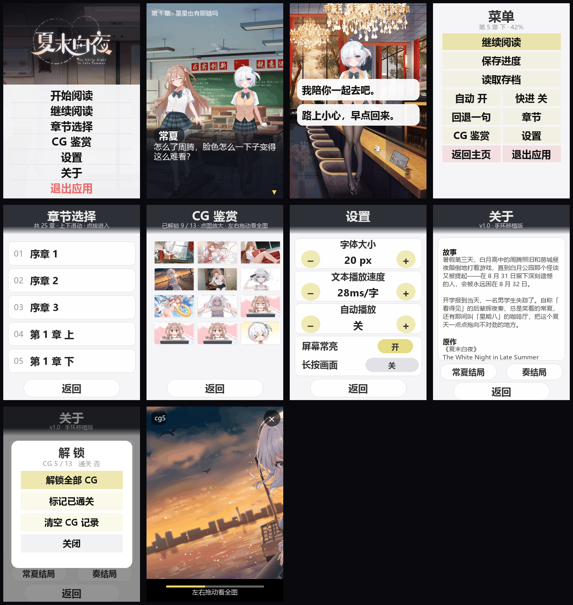

# 夏末白夜 · 小米手环 9 Pro 版（Vela 快应用）

把 PC 版 Ren'Py 视觉小说《夏末白夜》搬到 **小米手环 9 Pro（336×480 方屏）** 上阅读。
剧本解释器与手环适配思路参照 [galgod-band](https://github.com/mcpotato1123/galgod-band)，
界面按 [limelight-lemonade-jam-miband](https://github.com/mcpotato1123/limelight-lemonade-jam-miband)
的浅色卡片风格重做；剧本、立绘、背景、CG 全部从 PC 版解包得到，代码按本作数据重写。

> 仓库里已包含处理好的素材与编译后的剧本，**只想打包上手表的人不需要原作文件**；
> 只有要重新解包时才需要自备 PC 版《夏末白夜》。

```
25 章 / 19,404 条指令 / 13,162 句台词（约 33.4 万字）· 指令可达率 99.4%
30 张背景 · 13 张 CG（16:9 原图缩到 853×480，鉴赏页可拖动看全）· 4 名角色整身立绘 + 店长 4 姿
仓库 9.1 MB · 打出的 rpk ≈ 5.7 MB
```



---

## 一、目录

```
thewhitenightInlatesummer-band/
├─ package.json             aiot-toolkit 依赖与构建脚本
├─ src/
│  ├─ manifest.json         包名 com.thewhitenightInlatesummer.band / 路由 / designWidth:336
│  ├─ app.ux                应用入口
│  ├─ common/
│  │  ├─ reader.js          字号/速度/自动、分页算法、storage 封装、存档槽
│  │  ├─ vm.js              剧本解释器（纯逻辑，页面与模拟器共用）
│  │  ├─ assets.js          生成：BG/CG/SPRITES 清单 + 路径函数
│  │  ├─ story/
│  │  │  ├─ index.txt       生成：章节表 + 分块表（内容是 JSON，用 .txt 扩展名）
│  │  │  └─ chunk-000.txt…  生成：152 个分块，每块 128 条指令
│  │  └─ img/
│  │     ├─ b/ 背景 30 张（672×480）├─ s/ 整身立绘 210×420 + 脸部差分 + meta.json
│  │     ├─ w/ CG 原图（853×480）├─ t/ CG 缩略图（96×54）
│  │     ├─ ui/ 首页图、官方 logo、headbar/footbar/board 装饰、锁定占位、icon
│  └─ pages/                index / game / chapters / saves / cg / settings / about
├─ sim/                     浏览器模拟器（file:// 直接打开，无需服务器）
│  ├─ index.html            336×480 表盘壳，桌面预览
│  ├─ app.js                渲染与交互（与 .ux 同一套几何常量）
│  ├─ data.js               生成：整份剧本（1.3 MB）
│  ├─ vm.bundle.js          生成：vm.js 去掉模块语法
│  └─ assets.bundle.js      生成：assets.js 去掉模块语法
├─ tools/
│  ├─ build_story.py        Ren'Py AST → 手环指令流（含选项/跳转/立绘状态）
│  ├─ build_assets.py       背景 672×480、立绘 143×380 拆脸、CG、图标
│  ├─ check_story.py        校验：分块、跳转、章节、素材引用、可达率
│  ├─ build_sim.py          产出 sim/ 的三份生成文件
│  ├─ preview_ui.py         用真实素材合成 7 张界面图（preview/）
│  ├─ build.js              构建包装（预检 + aiot build + 产物校验）
│  └─ _renpy/               解包阶段复用的 RPA/AST 读取器
└─ preview/                 界面预览图
```

## 二、怎么跑

### 浏览器里先看（不需要任何环境）

双击 `sim/index.html`。点画面推进，向下拖动开菜单，菜单里可选章节。
模拟器与手环版共用 `vm.js`、同一份剧本、同一套像素几何，看到什么就是手环上什么。

### 构建 rpk

要求 Node 18+、npm（首次需要联网装 `aiot-toolkit`）：

```bash
npm install
npm run build        # → dist/com.thewhitenightInlatesummer.band.debug.1.0.rpk
```

- **debug 包可直接侧载**，不需要签名证书；`npm run release` 才要 `sign/private.pem` + `sign/certificate.pem`。
- 包名是 `com.thewhitenightInlatesummer.band`（按你给的写法保留大小写）。
  若 `aiot` 校验包名只认小写（部分版本是 `^[a-z][a-z0-9_]*(\.[a-z][a-z0-9_]*)+$`），
  把 `src/manifest.json` 里改成全小写 `com.thewhitenightinlatesummer.band` 即可，
  `tools/build.js` 自动跟随 manifest 取名，不用改别处。
- `aiot` 每次构建都会清空 `dist/`，要留旧包先拷走。
- Windows 上 aiot 收尾 `rimraf` 临时目录会报 EPERM（`node_modules` 是 junction），
  **此时 rpk 已经生成**，`tools/build.js` 已经把这种情况当成成功。
- 侧载：手表装 Astrobox → 设置里打开「蓝牙与安全」→ 登录小米账号 → 连上设备 →
  「探索」→「安装快应用」→ 选 rpk。官方文档说目前只支持 Xiaomi Watch S4，
  9 Pro 不在列表里，能不能装只能试；装完在应用列表里找「夏末白夜」。

### 重新生成数据

```bash
python tools/build_story.py     # 从 ..\TheWhiteNightInLateSummer\game\*.rpa 重新编译剧本
python tools/build_assets.py    # 从 ..\解包输出 重新出图（依赖上一步的立绘组合表）
python tools/build_sim.py       # 刷新模拟器数据
python tools/preview_ui.py      # 重新出预览图
python tools/check_story.py     # 校验（应为 RESULT OK）
```

顺序很重要：`build_assets.py` 要读 chunk 里的表情组合来决定生成哪些脸部差分。

## 三、实现要点（照 galgod-band 的做法）

屏幕按 **336×480、designWidth 336** 写，1px = 1 物理像素，所有 CSS 数值直接写像素。

- **界面风格**：照 limelight 版改成浅色系 —— 页面底 `#f5f5f7`，卡片是 `rgba(255,255,255,.92)`
  + `1px #e0e0e0` 描边 + 12px 圆角，菜单用淡黄条 `rgba(226,216,120,.27)` 配 24px 黑色 800 字重，
  顶部一条深色渐变条承载浅灰标题，阅读页用 `board.png` 做半透明对白板。
- **背景**：整屏 `object-fit: cover` 铺满（不再做 672 宽全景平移，那是上一版 galgod 风格的做法）。
- **立绘**：整身立绘，画布 210×420（0.5 比例）。裁切窗口取角色所有图层的**并集包围盒**
  （含双臂与脚），再按比例补足宽度——之前按胸像裁、按眼睛居中，结果手被切在框外、腿也没有，
  看着像个长方形。同台人数决定显示尺寸：1 人 200×400 居中、2 人 168×336 左右、3 人以上
  110×220 并排；**底边对齐屏幕底部（480）**，脚踩在画面下沿，对白板改成自上而下的透明渐变，
  腿透过板子仍可见，又不会在人物身上切出一条硬缝。
  源文件里的 `arm up/down` 是**姿势差分**（不是缺失的胳膊），底图本身双臂俱全，故不再叠加。
- **排版**：`lineH = 字号+4`、`cpl = floor(310/字号)`、`lpp = min(6, floor(144/lineH))`
  （20px 字号时每页 6 行 ≈ 90 字），分页按当前字号现算，字号 14–30 可无级调；
  断行优先落在 `，。！？；：、）」』…—` 之后；一句话超一页时**均分**（7 行拆 4+3 而不是 6+1），
  短尾巴并回上一页。
- **正文**：6 个固定 `<text>` 槽位，位置/字号/行高由 `s0..s5` 动态注入（避免动态节点）。
- **打字机**：`speed` 毫秒/字，50ms 一跳按 `elapsed/speed` 追进度；快进时 0 延迟、220ms 连播，
  遇选项/结局自动停。
- **半透明一律 rgba**，不用 `opacity`（真机会把整棵子树离屏合成，带子节点的容器画成横条纹）。
- **页面只用 `protected`**，不写 `data`（两者共存会直接让页面 VM 创建失败）。
- **所有点击入口 400ms 防抖**（`lockTap`）：一次触摸可能同时触发 touchend 与 click。
- **只用 `<list>`**，不用 `<scroll>`；立绘/正文用固定槽位，不做动态增删。
- **页面里的元素一律写绝对定位（`position:absolute` + top/left），或者塞进 `<list>`**，
  不依赖 `<div>` 的默认排版方向。设置页原来用一排带 `margin` 的 `.row` 靠流式排布，
  在真机上全叠在一起、加减号也点不动——改成逐行绝对定位后正常。
- **`<scroll>` 里必须写 `flex-direction: column`**：Vela 默认是横向排列，设置页原来只显示
  第一块（字体大小）就是漏了这句；普通 `<div>` 容器同理。
- **改完素材要重打模拟器**：`tools/build_assets.py` 结尾会自动跑一遍 `build_sim`，
  但如果你只手动跑了 `build_story.py`，`sim/assets.bundle.js` 里的立绘元数据（脸的位置）
  会停留在上一版，浏览器里就会看到五官跑到胸口——`tools/build.js` 现在会做这项一致性检查。
- **别把颜色写在行内 style 里跨主题复用**：关于页的行内样式还留着旧深色主题的浅色字，
  换成白底后就糊了——主题色统一放 CSS class，行内只留字号/行高。
- **别把状态挂在没声明的属性上**（比如 `this.settings`）：页面 VM 不保证保留，
  读写就会抛 `TypeError`、点了没反应。状态统一写进 `protected`，处理函数直接算新值。
- **主界面用原作素材**：背景取自 `gui/lapis_lazuli/main_menu/background_t.webp`，标题是官方
  `pc/logo/logo_o.png`（浅色版，压暗背景后才读得清），应用图标是 `gui/window_icon.png`
  （辉夜奏头像）。三张图都从 `gui.rpa` 里抽出来放在 `..\解包输出\其他\原作UI`，由
  `tools/build_assets.py` 的 `build_title()` 裁成 336×480 / 192×192。
- **退出**：主页菜单最后一行「退出应用」（红色，避免和「关于」误触）、阅读菜单右下也有一个，
  都调用 `this.$app.exit()`
  （README 里记过：Vela 只能用 `$app.exit()`，没有别的方式关掉快应用）。

## 四、剧本是怎么来的

`build_story.py` 直接把 Ren'Py 的 `.rpyc`（`RENPY RPC2` 容器里的 pickle AST）展开成指令流：

| 指令 | 含义 | 来源 |
| --- | --- | --- |
| `s` | 台词 | `Say` / `TranslateSay`（两者互补，同一行不会重复） |
| `b` `p` `h` `g` | 背景 / 立绘 / 隐藏 / CG | `Scene` / `Show` / `Hide`，含 `at` 位置与 `e_/eb_/m_` 表情属性 |
| `m` | 选项 | `Menu`，选项块编译成独立分支并回落到菜单之后 |
| `j` `q` | 跳转 / 条件跳转 | `Jump` 与 `kanade_love > tsangxia_love` 这条分歧 |
| `v` `n` `d` `c` `e` | 好感度 / 常夏改名 / 日期 / 章节名 / 结局 | `Python` 赋值与章节变量 |

- 230 个标签、197 处跳转全部在编译期解析成下标，运行时不查表。
- `changxia_name` 的改写被保留：序章开头显示「？？？」，身份揭晓后才变成「常夏」。
- 章节名取自脚本里的 `chaptername`（如「星星也有眼睛吗」），会显示在顶部胶囊里。
- 只有一条分歧（第 5 章末按好感度进常夏线 / 辉夜奏线），编译成 `q` 指令；
  菜单里也可以直接跳任意一章。

## 五、已知限制

- **只有文本**，没有语音/音乐/视频（`audio.rpa`、`music.rpa`、`video.rpa` 未解包）。
- 立绘只有 3 个槽位：个别场景 4 人同框时第 4 个会被挤掉（原作是全屏自由位置）。
- `cg4_r` 这类 CG 差分件在原素材里缺图，显示时直接略过。
- 章节从任意处进入时，若该章开场就是台词（而非先切背景），会沿用上一场景背景一瞬。
- 真机适配仍在打磨：模拟器与校验脚本覆盖了数据与交互逻辑，字体、性能、滑动手感仍需实机确认。
- 没有语音/音乐，也不含原作 UI 图片（除首页背景、logo、图标三张）。
- 非官方同人移植，素材版权属原作方，仅供个人学习交流。

## 六、彩蛋与捷径

**连点标题「关于」7 下**会弹出解锁面板（和 galgod 版一样的彩蛋位置）。
面板打开后 0.9 秒内不响应点击、关闭后 0.5 秒冷却，刚开/刚关那一下不会被同一串连点反复触发；
「关于」页的返回手势也会在刚点过标题的 1.5 秒内被吞掉，避免连点被系统判成返回把页面带走。

| 按钮 | 作用 |
| --- | --- |
| 解锁全部 CG | 一次点亮全部 13 张（等价原作 `persistent.cgs` 全开） |
| 标记已通关 | 写入 `cleared` 标记 |
| 清空 CG 记录 | 把 `cgSeen` 清空，方便重试 |
| 关闭 | 收起面板 |

面板里还会显示当前 `CG x / 13` 与是否通关。底部另有「常夏结局 / 奏结局」两个快捷键，
直接跳到两条线的第 10 章下。

> 本作 PC 版在现有归档里没有独立的「后日谈」剧本（25 个 `_story/*.rpyc` 里搜不到相关标签或文本），
> 所以没有做「后日谈解锁」，只给了直达两条线结局的按钮。

## 七、CG 鉴赏的翻页

原作 CG 是 16:9 的长图（3840×2160 / 3820×2160），构建时**不再裁剪**，只缩放到 **`img/w/<id>.png`（853×480）**：
正文里用 `object-fit: cover` 显示（视觉上等于居中裁切，但文件就是原图），鉴赏页打开同一张，
用 `left` 平移看全。

点开任一 CG 后进入全屏，**左右拖动**平移画面；拖不动（部分固件不派发 `touchmove`）时，
点左右各 48px 的热区或轻扫一下，每次平移半屏。底部进度条显示当前看到长图的哪一段，
右上角 `×` 关闭。所有平移都改 `left`，不用 `transition`（真机上补间会画出接缝）。

## 八、排障（真机踩过的坑）

**症状：装好能打开、能翻页，但一进正文就黑屏/只剩错误提示。**
真机日志里是这两行：

```
jse_file open file: .../common/story/index.txt, 1, 0
===Error:=== file.readText call success callback error: InternalError: invalid parameter :path
```

原因：`index.txt` 里分块路径写成了裸文件名 `chunk-000.txt`，`@system.file.readText` 只认
以 `/` 开头的应用资源路径（`/common/story/chunk-000.txt`），于是读完索引、读第一块时就抛
`invalid parameter :path`，页面停在初始化。已修复（`tools/build_story.py` 写入完整
路径，`vm.js` 对裸文件名兜底补前缀）。

**症状：`[AIOTJS] Unknown style - textShadow`** —— Vela 不支持 `text-shadow`，只会打日志
并丢弃；现已从 `.logo` / `.name` 里去掉（改用深色底衬托字）。

其它确认正常、不用再查的日志：`i18n` 目录缺失、`__create_dir ... ,17`（errno 17 = 已存在）、
`setDesignResolution` 连续多次切换，这三个参考工程也有，属正常。

## 九、参考与致谢

- [mcpotato1123/galgod-band](https://github.com/mcpotato1123/galgod-band)：336×480 手环版 Vela 引擎
  结构、点击/分页/存档等实现思路的来源（MIT）。
- [mcpotato1123/limelight-lemonade-jam-miband](https://github.com/mcpotato1123/limelight-lemonade-jam-miband)：
  当前界面（浅色卡片、淡黄条菜单、顶部装饰条）的样式参照。
- 剧本与美术资源版权归《夏末白夜》原作方所有。

## 十、许可

- **代码**（`src/`、`tools/`、`sim/` 下的程序与脚本）以 MIT 许可发布，见 [LICENSE](LICENSE)。
- **游戏素材**（`src/common/img/`、`src/common/story/` 里的剧本文本、立绘、背景、CG）版权归原作方，
  这里仅作非商业同人移植使用；如版权方要求，会立即删除相关文件。
- 仓库不含签名私钥（`sign/` 已在 `.gitignore` 中）；`aiot` 首次构建会自行生成。
